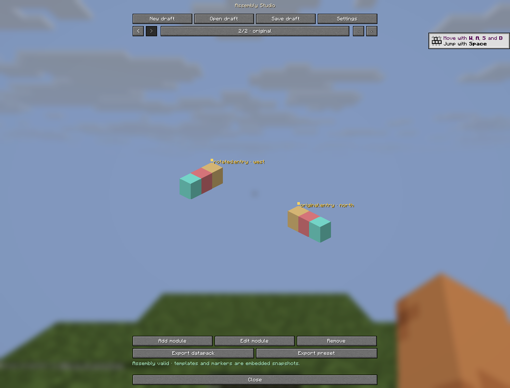

# Assembly Studio

Assembly Studio combines saved structure templates into a modular structure. Open the structure library and choose **Assembly Studio**, or use `/wa_assembly`. Authoring requires operator level 2 and a preset that permits the structure library. Preset export also requires level 3 and `developer_mode`.

## Build an assembly

1. Capture or import each source template through the [structure library](Structure-Library.md). Set its placement rules and safe spawn markers before adding it.
2. Choose **New draft** and enter an assembly ID such as `my_pack:watchtower` and a registered biome ID.
3. Choose **Add module**, select a saved template, and give the module a unique name. Set its local offsets, rotation and mirror.
4. Add the remaining modules. Use the arrows to orbit the complete voxel preview. Gold points show transformed spawn markers. Select the module name to review its source revision, placement rules and dependencies.
5. Use **Settings** for the assembly height offset, maximum supported slope and random rotation of the whole structure. Each module also retains its own placement rules.
6. Choose **Save draft**. Reopen the saved document to continue later.

Limits are 16 modules, 96 blocks per axis and 65,536 occupied cells. Each source template is limited to 32 blocks per axis. Saved draft JSON is limited to 8 MiB; complex states or metadata may reach that limit before the cell limit. Offsets are 0–95; a template extending past 96 makes the assembly invalid. Modules cannot share occupied cells or obstruct a marker's two air cells. An unfinished draft can be saved while its geometry is invalid, but it cannot be exported.

Modules contain captured templates, block states, permitted decorative metadata and markers. Changing or deleting a library source later does not change an assembly. To take a newer source revision, remove that module and add it again. Rotation and mirroring transform states and marker directions together. Preview colours identify block types; the preview does not display block textures or container contents.

## Export for new worlds

**Export datapack** writes a ZIP under the world's `generated/worldarchitect/assembly-exports/` directory. It contains the registered structure definition and a native random-spread placement set. Install it in a new world or modpack. Select the structure in a managed Single Block or Layered dimension with the matching biome. Modular assemblies require managed solid terrain; Original Generation and Void do not supply their placement surface.

**Export preset** creates a validated bundle in `config/worldarchitect/exports/`. Choose an unused export ID, target dimension, release and seed. The selected dimension becomes flat stone with the assembly enabled. Other dimension profiles are retained. A compatible native End keeps its central dragon arena. Modded dimensions require a compatible Single Block adapter. The export includes the definition and captured resources; supplying mods and dimension datapacks must still be installed.

Exports are inert files. They do not install resources or change the world where you authored them. Existing export files and preset revisions cannot be overwritten. Install a bundle through the [modpack configuration](Modpack-Quick-Start.md), then restart before creating a new world.

## Multiple authors and saved worlds

Drafts live in `world/data/worldarchitect/assemblies/<namespace>/<path>.json`, separately from immutable generation snapshots. Two authors may open the same revision. After one saves, the other must reopen before saving; the server refuses an obsolete save.

Editing sessions expire after 30 minutes without an action. Save before leaving. A server retains at most 16 sessions and an estimated 64 MiB working set; it refuses new work when that budget is full. Closing an editor releases its session. Save/export actions recheck permissions and the server's current editor token.

Back up drafts with the complete world. Exporting a revised assembly affects new worlds; existing saves continue using their pinned definitions and templates.

Version 1.3 adds [Procedural Pools](Procedural-Pools.md) for seeded branching layouts. Static assemblies retain their existing definition and placement path.

Preset exports read the live dimension registry, including mod-added dimensions outside the selected starting preset. Replacing a modded dimension still requires its registered adapter to support Single Block terrain.

## History and interrupted sessions

Use **History / organize** for Undo/Redo, module duplication and module ordering. Pool choices can also be reordered from their diagnostics menu. Completed edits write a separate recovery document. Reopening after a disconnect requires an explicit Restore/Discard choice; a newer saved revision is never overwritten by old recovery. Histories share the existing server memory budget, and edits keep current permission/token/serial/revision checks. See [Draft History](Draft-History.md) and [constrained pools](Procedural-Pools.md).
