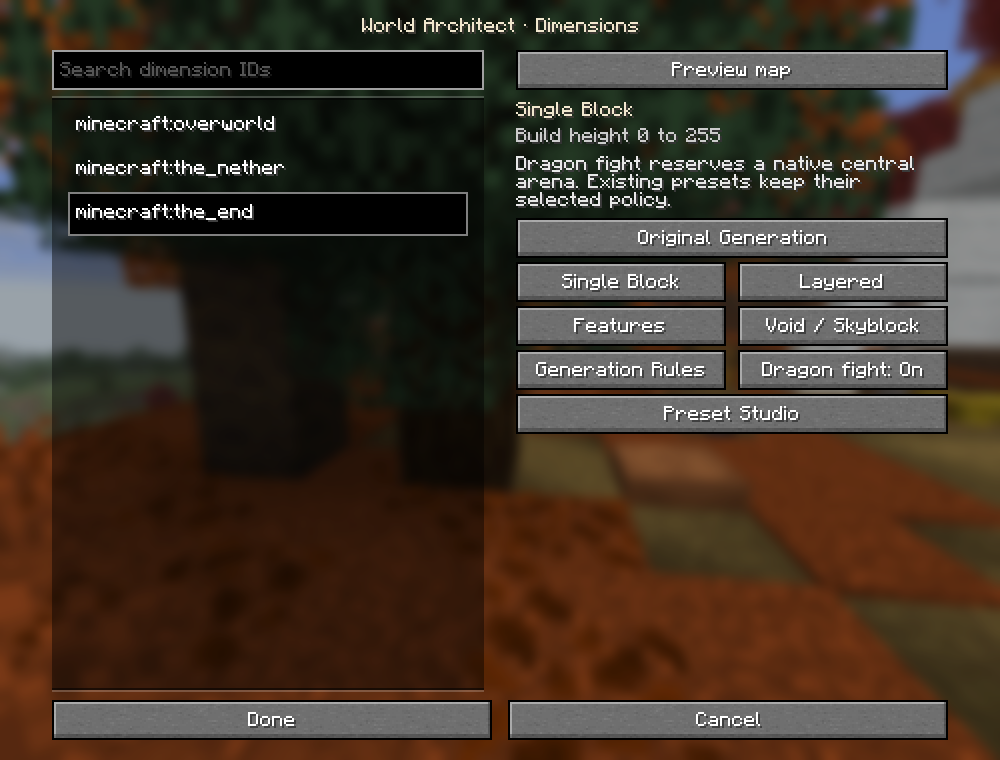

# End progression

Custom End terrain can keep the vanilla dragon fight. In the dimension manager, select the custom End and turn **Dragon fight** on. It defaults on when the UI first creates a solid-terrain End profile. Imported presets and Void/Skyblock profiles retain their selected policy.

The mode reserves blocks **−256 through 255** on both horizontal axes, corresponding to chunks **−16 through 15**. Minecraft generates its native island, biomes, spikes and crystals inside this square. The entrance platform, dragon, exit fountain and inner gateways follow normal progression. Outside it, Worlds Unwritten uses your custom terrain and feature rules.

Kill the dragon to open the exit portal and create a gateway. Later kills continue the gateway sequence. Place four end crystals around the fountain to respawn the dragon. Progress persists through Minecraft's native fight data, including across server restarts.

Gateways keep their paired return destinations and can create an End-stone landing island if needed. Worlds Unwritten checks the arrival and searches within 16 blocks for a safe position. If none exists, travel is refused with a message so the destination can be repaired.

The reservation controls generation; players can build and break blocks there normally. Custom generated structures cannot overlap it. End entry uses the native platform when access is allowed. Exit travel retains bed and personal-island respawn handling.

Void and Skyblock authors can enable the mode explicitly. The native arena replaces any starting template inside its reservation; configured empty terrain continues outside. Leave it off when the End must remain completely empty.



## Presets

Add this to the End generator's dimension profile (`dimension_profile` for solid terrain, `dimension` for Void/Skyblock):

```json
"end_progression": {"version":1,"mode":"vanilla_arena"}
```

Omitting the field retains the previous disabled policy. Version 1 requires `minecraft:the_end`, a native fight and a build range of Y 0–255. Its algorithm and native dependencies are saved with the world.

The option is chosen before world creation. Updating the mod does not add an arena, enable a fight or change unexplored chunks in an existing custom End save. Use **Original Generation** for an entirely native End. Try the [End example](https://github.com/GWSheridan/Worlds-Unwritten/tree/v2.1.0/examples/end-progression) in a new world.

## Progressive cell campaigns in 2.1

New shared cell campaigns can combine locked outer terrain with the native fight. In Cell World Studio choose **Shared End progression** before creating the world. The native arena stays open, and permanent outer gateway landings do not spend expansion credits. Dragon objectives require a verified native kill and pay once; later kills and crystal respawns retain vanilla progression. A new gateway preserves blocked destinations and uses a safe arena fallback. See [Cell Worlds](Cell-Worlds.md#shared-progressive-end) for limits and [the campaign examples](https://github.com/GWSheridan/Worlds-Unwritten/tree/v2.1.0/examples/campaigns) for complete configurations. Existing worlds keep their previous End policy.
