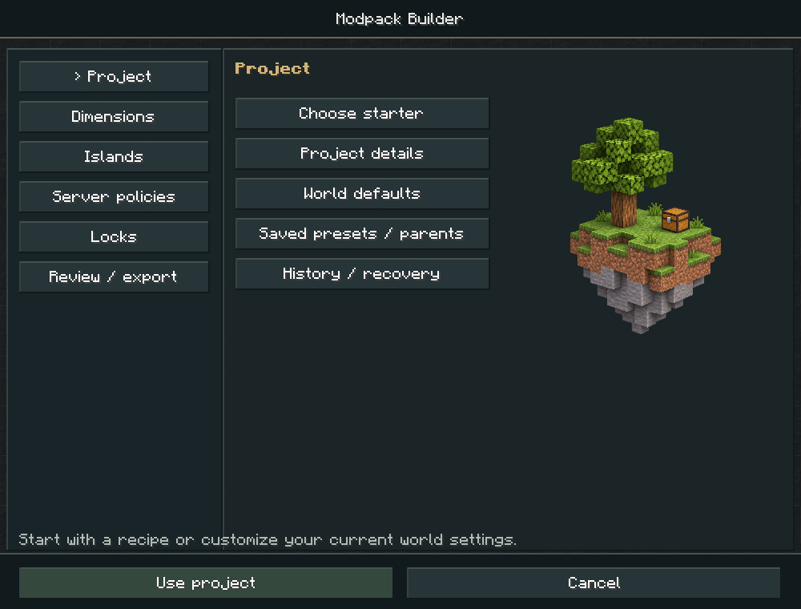

# Modpack quick start

1. Create a separate authoring instance with Worlds Unwritten and every required provider mod.
2. Choose **Worlds Unwritten · Dimensions → Customize → Builder** when creating a world. In **Review / export**, choose **Authoring setup** and restart the instance. The interrupted project remains available through draft recovery. On a dedicated authoring server, its console can run `worldsunwritten modpack authoring_enable` before restarting.
3. In **Project → Choose starter**, select Skyblock, void, mixed dimensions, or one of the six [cell-world recipes](Cell-Worlds.md), including Hex Continents and Expanding One Chunk. Set a unique project name, preset ID, title, author and release in **Project details**.
4. Use **Dimensions** for terrain and features. In **Islands**, edit the catalog, open Island Studio and configure allocation. The native End remains available for ordinary dragon progression.
5. Set new-world spawn, portal and protection defaults in **Server policies**. Use **Locks** to select generation permissions and the independent runtime permissions.
6. In **Review / export**, inspect validation and dependencies, save a version, then export a client/server installation. Both sides receive the same preset archive with developer mode disabled. Keep each saved revision for future releases.
7. Install matching mods in clean client and server instances. Copy the corresponding exported `config` folder into each. The exported `server.properties` is a new-server example. Create fresh worlds and check spawning, allowed edits, rejected edits and persistence after a restart.
8. Distribute the configuration, required-mod list and installation instructions. Bundle revisions are independent of the mod version. Use a new release when changing a saved revision.

## Test an exported project

The optional test kit runs with Java 25, a matching NeoForge, Forge or Fabric server, the exported project and any required provider JARs. For Fabric, point the kit at the dedicated launcher JAR and include Fabric API with the providers. Extract the complete ZIP and run `run.cmd --help` or `sh run.sh --help`.

Choose a new output folder and accept the Minecraft EULA using the documented flag. The kit copies the selected runtime libraries into that folder and checks a disposable server's startup, islands, markers, starter contents, configured runtime locks and restart snapshots. Cell worlds also check reserved-cell activation and void gaps. Logs and `results.json` stay there. Follow with real multiplayer, progression and external-mod gameplay checks before distributing the pack.

Start with the supplied [partial and full examples](Example-Presets.md). Read [Preset Studio](Preset-Studio.md), [Preset Reference](Preset-Reference.md) and [Locks and Server Enforcement](Locks-and-Server-Enforcement.md) before changing a production pack.

Existing worlds keep their original embedded templates, rule order, dependency versions and bundle archive. New installed defaults apply to future worlds.
