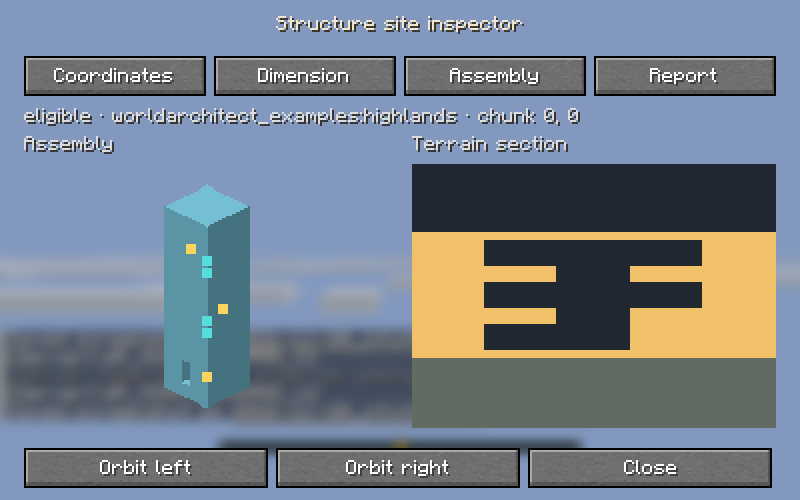

# Structure site inspector

The site inspector runs an assembly's production placement planner against the base terrain of a saved preset. It does not load a level, create chunks, place blocks or change saved generation.

On an authoring server with developer mode enabled, a level-3 administrator can run:

```text
/worldsunwritten site studio my-preset 1.0.0
```

The server must already have that immutable Preset Studio version. The active pack must permit the structure library. From Preset Studio, choose **Help / sites → Structure site inspector** while connected to an authoring world. That route also checks that the server has the identical saved bundle. Save a changed draft as a new version first. Offline new-world editing cannot start a server preview.

Choose a managed solid-terrain dimension and an assembly selected in that dimension. Enter the exact seed and **chunk** X/Z coordinates. Coordinates are not block positions. The saved preset version stays fixed; changing these test inputs does not edit it.

The view shows the assembled geometry, gold spawn markers, cyan connection endpoints and a base-terrain cross-section through the centre Z. The report records the resolved origins, water intersections, source fingerprint and the native candidate chunk for that placement region.



This example uses an archived preset, so its original resource ID remains visible. New presets use the `worldsunwritten` namespace.

An **eligible** result means the production planner accepted the base-terrain geometry. It does not promise an automatic start: native candidate selection, earlier template rules, End reservations, other structures, features and later ticking remain authoritative. A **rejected** result explains the first failed check. An **incomplete** result has no placement decision; retry or simplify the sample. Use the [test workbench](Test-Workbench.md) to check actual generated chunks.

Each request has a cooperative 500 ms sampling budget. Work uses one background worker with a bounded queue. A newer request cancels its predecessor, closing cancels the session, and old results cannot replace a newer view. Sessions expire after thirty minutes, with at most sixteen authors and a shared estimated 64 MiB working budget. Current permissions, pack policy, session token, request serial and saved source fingerprint are checked on the server. Reports and previews are not uploaded automatically.

See [Assembly Studio](Assembly-Studio.md), [Procedural Pools](Procedural-Pools.md), [Regional Terrain](Regional-Terrain.md) and [World Generation Rules](World-Generation-Rules.md).

## Find several sites

In 1.6, choose **Tools → Search nearby sites** after selecting a dimension and assembly. Set a center chunk, radius of 1–128 chunks and candidate limit of 1–256 native placement regions. The finder uses all matching placement bindings, samples only their native candidate chunks and returns up to 32 eligible sites. It stops after five seconds of cooperative work; individual samples retain their 500 ms budget. A time, result or candidate limit produces an explicitly incomplete report. Results are a bounded sample, not a promise that every site or the globally nearest site was found.

**Tools → Search results** opens a coordinate list. Select one to inspect its geometry, foundation supports, clearance, transformed markers and terrain section. An eligible search result agrees with the production base-terrain planner; later generation and ticking can still affect the live site. No search step loads chunks or changes generation files.

**Tools → Export search report** writes a new JSON file to the server's `config/worldsunwritten/site-reports/` directory. Reports include exact seed, dimension, structure, bounds, limits, source release and SHA-256 fingerprint. Use a simple filename; existing reports cannot be overwritten. Export requires the current permission, pack policy, token, serial and unchanged saved source. It never uploads a report.

**Tools → Cancel search**, a replacement request, closing or losing permission invalidates pending work. A changed source fingerprint also refuses late results and export. Sessions and memory limits are shared with single-site previews.
