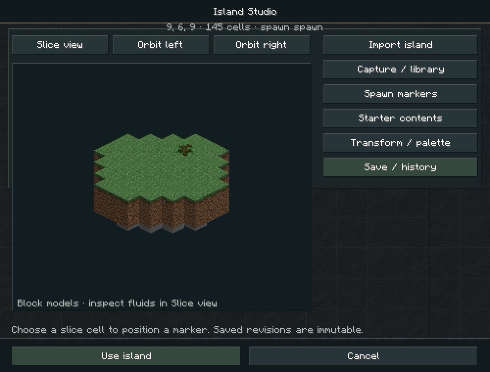

# Void and Skyblock

## Modpack Builder and Island Studio

For a new pack, open **Customize → Builder** and choose a Skyblock starter. The **Islands** section supports up to 16 named types, shared, personal or scoreboard-team allocation, fixed templates, seeded weighted layouts and optional player choice. Personal and team allocations use the Overworld; other dimensions can have their own shared island. Existing saves keep their original format and allocation rules.

Open **Edit island catalog → a type → Open Island Studio** to import a vanilla `.nbt`, Sponge v3 `.schem` or saved `.island.json`, capture an authoring build, or choose a Structure Library template. Rich islands fit 64 blocks per side and 65,536 occupied cells. They support registered block states, contained fluids, waterlogged blocks, supported gravity blocks, signs, banners and explicit chest/barrel contents. Machine block entities, entities, active portals and privileged blocks are rejected. Ordinary library and assembly templates retain their existing 32-block budget.



The 3D preview uses Minecraft's resource-pack block models. Large views use a bounded model sample. **Slice view** displays each exact cell, including liquids; select an air cell there to add or move a spawn marker. A spawn marker needs a safe floor and two air cells inside the saved bounds. Rotate, mirror and palette changes validate the complete island before applying.

Choose **Starter contents** to select a chest or barrel, a slot, a registered item and an amount. Include captured inventories only when you intend to distribute them. Starter items are written during chunk generation and stay consumed after reconnects and restarts. Saving a revision preserves its block states, supported metadata, contents and markers together.

For capture, join a separate authoring world with developer mode enabled and administrator permission. Use `/worldsunwritten island pos1` and `/worldsunwritten island pos2`, then **Capture selected build**, or `/worldsunwritten island capture_selected name release true`. A dedicated server saves the `.island.json` in its own `config/worldsunwritten/islands/`; transfer that revision to the authoring client and import it into the project.

Choice layouts assign a type to every slot from the seed before chunks generate. Players wait safely at the protected shared lobby and claim a vacant matching slot through the choice screen or `/worldsunwritten island choose`. A changed availability list refreshes before accepting a new choice. For teams, the first successful member reserves the team's island; other members travel to the same assignment. Claims are persisted before travel. Existing explored islands keep their blocks when ownership changes.

When a rich Skyblock End profile preserves the native dragon arena, its shared island starts at `512, 0` outside the reserved central square. Vanilla End entry and dragon progression continue to use the central arena.

## Legacy Void / Skyblock editor

In **Create New World → World**, select **Worlds Unwritten · Dimensions** and open **Customize**. Select a dimension and choose **Void / Skyblock**. Apply the profile and choose **Done** in the dimension manager.

**Use Empty Void** generates air throughout the dimension's build range. An empty Overworld requires explicit consent because it has no safe spawn. Vanilla Nether and End portals refuse arrival into pure void, which prevents their automatic exit frame or obsidian platform. An administrator can enter with a teleport command.

## Starting islands

**Use Skyblock** generates the selected island template. Enter its bottom Y and a local spawn marker in `X Y Z` order. The marker is the player's feet position, measured from the template's low corner. It needs two cells of air over a safe full block. The built-in Classic island uses marker `4 4 4`.

For a custom island, save a vanilla structure `.nbt` with a structure block in a separate build world. Include both cells of spawn headroom in the selected bounds. Enter the file path and its local marker in the editor, then choose **Import .nbt**. The template may be up to 32 blocks on each axis and can use registered block states, including modded blocks. This import supports one palette and block states only. Fluids, block entities and their contents, entities, falling blocks, and active Nether or End portal blocks are outside this template format.

The saved dimension embeds the template, so moving or editing the original `.nbt` has no effect. If players obstruct or remove the spawn marker, the server searches for a clear spot over a safe floor within the same template footprint, then tries the shared island. If both are unusable, the server refuses the affected spawn. Ordinary saved logout positions and valid beds or respawn anchors continue to apply. Vanilla portal arrivals into Skyblock use an island marker or a valid personal return point from the End.

## Multiplayer islands

Set **Personal slots** in the Overworld to a number between 1 and 4095. Use `0` for one shared island. Each first-time player claims one slot by UUID. The shared island is slot 0. Personal slots are distinct origins arranged in rows of 16. Spacing is measured between origins, in multiples of 16 from 64 to 4096 blocks. The generator reserves the grid, so sections explored before allocation already have the same island layout. When all slots are assigned, the server tells unassigned players that the islands are full. Existing players can rejoin.

Include `worldsunwritten-islands-v1.dat` in any world backup or move. If it is missing or unreadable, the server stops before opening the saved world. Slot ownership controls spawn assignment and access when island protection is enabled.

## Spawn policies and island administration

Operators with permission level 3 can configure initial joins, death respawns, and portal arrivals with `worldsunwritten spawn`. Policies use safe fixed positions, assigned islands, scoreboard teams, library markers, or saved markers in generated modular structures.

```text
/worldsunwritten spawn set initial team minecraft:overworld
/worldsunwritten spawn set respawn team minecraft:overworld
/worldsunwritten spawn set portal team minecraft:overworld
/worldsunwritten spawn set portal fixed minecraft:the_nether 0 67 0
/worldsunwritten spawn set respawn marker minecraft:overworld builds:hall entry 64 90 -32 cw90 left_right
/worldsunwritten spawn set initial generated wa_example:workshop wa_example:village 1 81 1 main entry
/worldsunwritten spawn clear respawn
```

Fixed positions are feet coordinates. Place a library structure before selecting its marker. Generated marker policies identify a structure, a position inside its saved bounding box, the module name, and its marker. Set commands validate the requested destination before saving it. The server checks live support, headroom, build limits, and the world border at arrival. It searches up to four blocks from a fixed or structure marker and can fall back to an island or terrain spawn. It refuses an arrival when it cannot find a safe destination.

Initial policies apply when a player has no saved position. A valid personal respawn point takes priority over the configured death-respawn policy. Portal policies apply to players entering the selected dimension. The bundled spawn lock also governs policy edits.

Team policies use Minecraft scoreboard membership. Create a team and add players with the vanilla `team` commands. The first arriving member reserves one team slot, and members share that island. Team reservations and player assignments use the same capacity. Existing individual assignments remain allocated when a player joins a team.

```text
/team add builders
/team join builders PlayerName
/worldsunwritten island
/worldsunwritten island home
/worldsunwritten island list
/worldsunwritten island inspect 2
/worldsunwritten island reassign PlayerName 3
/worldsunwritten island swap FirstPlayer SecondPlayer
/worldsunwritten island team assign builders 4
```

All players can inspect their own assignment and use `home`. Other island commands require permission level 3. Reassign and swap commit the updated ownership before reporting success. Reassign requires an available slot, while swap exchanges two player assignments atomically. Use online player names or saved player UUIDs. Changes take effect on the next island home or policy-based respawn. The commands preserve the island's blocks and player-built contents.

## Optional island protection

Enable player block breaking, placement, and selected container protection independently. Protection covers each reserved island's entire horizontal spacing cell through the dimension's build height. Owners and members of its assigned scoreboard team have access. Operators at permission level 2 or higher can bypass Worlds Unwritten protection.

```text
/worldsunwritten island protection breaking true
/worldsunwritten island protection placement true
/worldsunwritten island protection containers true
/worldsunwritten island protection shared true
/worldsunwritten island protection container add minecraft:hopper
/worldsunwritten island protection container remove minecraft:barrel
```

Chests, trapped chests, and barrels are the default protected container types. Container protection also covers breaking those blocks. Both halves of a connected double chest must be accessible. The server checks open-container clicks again so a change of ownership or team membership can revoke an existing session, including a session opened before container protection was enabled. Set any flag to `false` to disable it. The `shared` flag applies the enabled protections to island 0. These controls govern player actions; they do not claim islands against automation or environmental damage.

Administration settings live in `data/worldsunwritten-administration-v1.dat`. Include that file and the island ledger in backups. The normal save records whether administration settings are required and rejects a missing file on reopening. Team reservations use allocation format 2 in the existing `worldsunwritten-islands-v1.dat` file. Versions without team-allocation support cannot open worlds using teams. The server continues to read earlier allocation files.

## Island Workshop

In Builder, go to **Islands → Island Workshop**. Use the name above each preview to choose an island from the catalog. **Supplies and spawn** lists the saved marker and container contents. It also flags containers that have a blocked lid or lack a simple walking route from spawn. **Play preview** opens world creation with the selected island in a fresh void save. Delete the preview through the Singleplayer world list when you finish.

To add a custom build, import a template or schematic through Island Studio. Choose a spawn marker with solid footing and room above it. Use **Import as island type** on the catalog to add the saved build. Review any imported inventories before including them in the pack.

## Dedicated server presets

Copy [the Skyblock example datapack](https://github.com/GWSheridan/Worlds-Unwritten/tree/v2.1.0/examples/skyblock) into the new world's `datapacks` directory. Enable `file/skyblock` with `initial-enabled-packs=vanilla,file/skyblock`. Set `level-type=worldsunwritten\:skyblock_demo` for a custom Overworld island with two personal slots, a shared Nether island, and an empty End. Set `level-type=worldsunwritten\:void_demo` for pure void in all three dimensions with unsafe Overworld spawn explicitly accepted.

Both presets use `type: "worldsunwritten:void"`. Omit `island` for pure void. On the Overworld, `allow_unsafe_spawn` must then be `true`. With Skyblock, `island.template` stores the bounds, marker, and blocks. `island.origin_y` sets the bottom of the template. `island.spacing` defaults to 128 and `island.personal_slots` defaults to 0. Secondary dimensions support a shared island. Create a new world to change the generator, template, or allocation grid.
